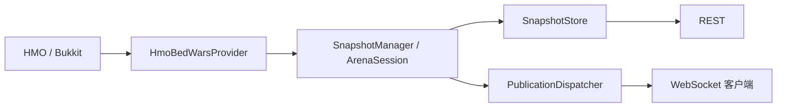

# Repository Guidelines

## Project Overview

BedCast 是 Paper 1.8.8 起床战争赛事直播数据插件，适配 HMO-Bedwars，通过 REST 和 WebSocket 提供多竞技场状态与事件。此仓库负责采集与分发，不实现 BedWars 玩法或直播网页。

## Architecture & Data Flow



- Bukkit/HMO 读取、事件接收和状态合并只在主线程执行；默认每 5 Tick 采集。网络线程只使用已发布 DTO，不访问 Player、Inventory 或 provider。
- `SnapshotStore` 为每个竞技场用 `AtomicReference<GameSnapshot>` 发布不可变快照。会话按竞技场隔离，换局生成新 `gameId`；离线选手和结算数据不能随在线名单消失。
- `PublicationDispatcher` 在单线程中排序首次快照与后续增量，主线程只做非阻塞提交。保留有界队列和慢连接断开机制，不改为每 Tick 广播完整快照。

## Key Directories

| 路径 | 职责与依赖边界 |
| --- | --- |
| `bedcast-core/src/main/java/dev/bedcast/` | `model/provider/state/snapshot/event`：纯 Java 模型、契约、会话与时间线；不引入 Bukkit 或 HMO 类型。 |
| `bedcast-provider-hmo/src/main/java/dev/bedcast/provider/hmo/` | 核心服务解析、1.8.8 背包采样与事件映射；HMO 类型仅留在此模块。 |
| `bedcast-plugin/src/main/java/dev/bedcast/` | `bukkit/config` 负责装配，`api/websocket/util` 负责网络协议与鉴权。 |
| `bedcast-core/src/test/java/`、`bedcast-plugin/src/test/java/` | 状态、不可变性、配置及实际网络协议测试。 |

## Development Commands

以下命令从仓库根目录运行：

```sh
mvn verify                         # 全模块测试、打包与 Shade
mvn -pl bedcast-core test           # 核心行为测试
mvn -pl bedcast-plugin -am test -Dtest=WebSocketNetworkTest -Dsurefire.failIfNoSpecifiedTests=false
mvn package -DskipTests             # 仅构建，不代替验收
```

若缺少 `com.andrei1058.bedwars:bedwars-api:0.2.4-beta`，且相邻目录已有匹配的 HMO 源码，先安装 API：

```sh
env -u BED_WARS_SERVER_DIR mvn -f ../HMO-Bedwars/pom.xml -pl bedwars-api -am install -DskipTests
```

产物为 `bedcast-plugin/target/BedCast-1.0.0-SNAPSHOT.jar`。运行时将其放入隔离 Paper/HMO 服务器的 `plugins/`，在该服务器目录启动 Paper，例如 `java -jar paper-1.8.8-445.jar nogui`；BedCast 本身没有独立 CLI 或 `java -jar` 入口。仓库未配置独立 lint、formatter 或服务端启动脚本。

## Code Conventions & Common Patterns

- Java 使用 4 空格缩进，类名 `PascalCase`、方法与变量 `camelCase`、常量 `UPPER_SNAKE_CASE`。沿用邻近文件的紧凑格式，不批量重排无关代码。
- 提交必须采用中文约定式提交：`<type>(<scope>): <中文说明>`，`scope` 可省略。`type` 使用 `feat`、`fix`、`docs`、`refactor`、`test`、`build`、`chore` 等标准类型；说明和正文使用中文，代码标识符保留原文。例如 `docs: 补充仓库开发指南`。
- 在 `BedCastPlugin` 显式装配组件，通过构造器传入 provider、store 和回调；不新增全局服务容器或 DI 框架。新增核心适配实现 `BedWarsProvider`，不让网络模块识别具体核心。
- DTO 使用 `final` 类与字段，复制发布前的可变集合。复用 `Immutable.map/list/json`；`extensions` 和事件 `data` 只接受可冻结的 JSON 值，禁止放入 Bukkit 对象。
- 区分当前 State 与瞬时 Event。HMO 购买/升级监听在 `MONITOR` 观察，候选事件延迟到后续主线程采集确认最终取消状态；不要在回调中假定交易已经完成。
- 保留稳定协议语义：单局 REST 请求必须带 `arena`；WebSocket 消息 `sequence` 不等同于 REST 事件游标或业务事件 `eventSequence`。
- 参数错误使用 `ApiResponse` 与稳定错误码。采集异常标记快照不可用并让接口返回 503，不吞异常后伪造零值或空比赛；停用时释放任务、监听器、端口与线程。

## Important Files

- `pom.xml`、各模块 `pom.xml`：Java 目标版本、provided API 和依赖管理；插件模块用 Shade 将 Gson、Java-WebSocket、SLF4J 重定位到 `dev.bedcast.internal`，不打包 Bukkit/HMO API。
- `bedcast-plugin/src/main/resources/plugin.yml`：插件入口和 `softdepend`；同目录 `config.yml`：服务监听、Token、Origin 白名单、采样间隔、事件容量及赛事轮次。
- `bedcast-plugin/src/main/java/dev/bedcast/bukkit/BedCastPlugin.java`：启停顺序、主线程调度及 HMO 停用联动。
- `bedcast-core/src/main/java/dev/bedcast/state/ArenaSession.java`：生命周期、离线名单、战斗派生状态、结算与事件去重。
- `bedcast-provider-hmo/src/main/java/dev/bedcast/provider/hmo/HmoEventListener.java`：真实事件来源、取消语义与去重。
- `bedcast-plugin/src/main/java/dev/bedcast/api/ApiRouter.java`、`bedcast-plugin/src/main/java/dev/bedcast/websocket/PublicationDispatcher.java`：路由/游标错误及首次快照/增量排序。

## Runtime/Tooling Preferences

- 使用 JDK 17 构建，`maven.compiler.release=11`；运行目标 Java 11/17，Bukkit API 固定为 `1.8.8-R0.1-SNAPSHOT`。不引入 Java 11 之后的语言/API，也不误用现代 Bukkit 的 `getItemInMainHand` 或新 Material 名称。
- 使用 Maven；没有 Maven Wrapper、Node/Bun 工程或前端包管理需求。HMO API 与实际服务器核心版本必须匹配。
- 服务默认仅监听 `127.0.0.1:8080/8081`。外部直播页需配置 Token 和精确 Origin 白名单，不为方便测试开放全部网卡或通配跨域，也不记录 Token。
- 不自动部署到现有赛事服，不顺带修改相邻 HMO 仓库源码。`target/` 已忽略，不提交构建产物或临时验收工具。

## Testing & QA

- 使用 JUnit Jupiter 5 与 Maven Surefire；没有配置覆盖率百分比门槛。新增回归测试应覆盖消费者可见的行为、边界与错误路径，不测试 getter 转发或源码文字。
- 核心测试使用内存 provider；网络测试在回环地址随机端口启动真实服务，使用 JDK `HttpClient`/`WebSocket`，通过 `try-with-resources` 清理。常规测试不需要 Minecraft 服务端或浏览器。
- 重点保留多竞技场隔离、离线统计、最终击杀不重复计数、终局/换局边界、事件窗口过期、鉴权、首帧顺序和深层不可变性覆盖。
- 修改 HMO 采集、生命周期或线程边界时，在隔离 Paper 1.8.8/HMO 服上验证受影响的真实路径，并观察 REST/WS 输出；fixture 或网络单测不能代替真实核心对接证明。
